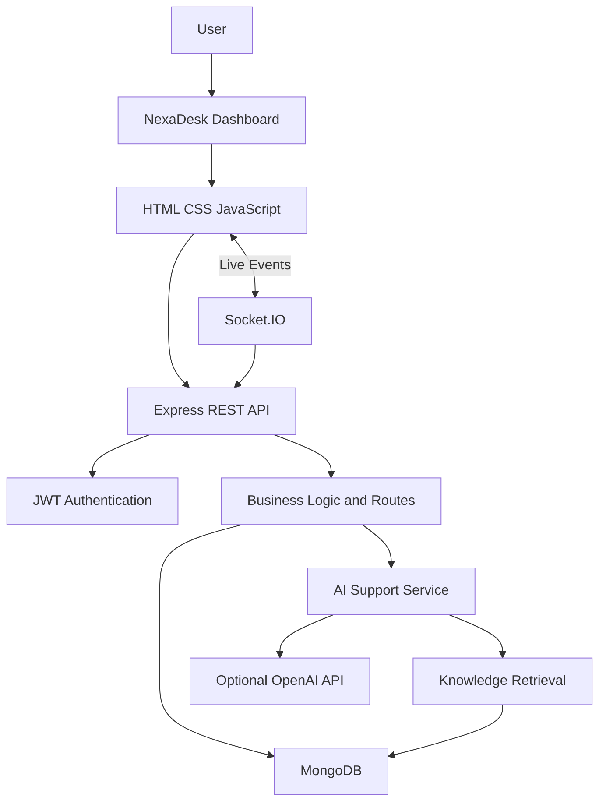

# NexaDesk — AI Customer Support Intelligence Platform

NexaDesk is a full-stack customer support management platform designed to help support teams manage customer queries, organize support tickets, collaborate with team members and generate AI-assisted responses.

The platform combines a browser-based dashboard with a Node.js and Express backend, MongoDB database, JWT authentication and real-time communication through Socket.IO.

## Project Overview

NexaDesk brings customer support operations into one centralized workspace. It provides ticket management, customer information, knowledge-base resources, analytics and an AI-assisted support workflow.

## Key Features

### Authentication and Security
- JWT-based user authentication.
- Secure password hashing using bcrypt.
- Role-based access control.
- Admin, manager and agent roles.
- Protected API endpoints.

### Ticket Management
- Create, view and update support tickets.
- Track ticket status and priority.
- Assign tickets to team members.
- Manage ticket conversation replies.
- Search and filter support tickets.

### Customer Management
- View customer information from ticket records.
- Access customer-related ticket history.
- Search customer records.

### AI Support Assistant
- Retrieve relevant knowledge-base articles.
- Generate support answers using retrieved information.
- Optional OpenAI Responses API integration.
- Local fallback when an OpenAI API key is unavailable.

### Knowledge Base
- Create and manage support articles.
- Organize knowledge resources by category.
- Retrieve relevant articles for support questions.

### Analytics
- View ticket statistics and support activity.
- Monitor ticket status and priority distribution.
- Export available analytics data.

### Real-Time Communication
- Socket.IO integration.
- Real-time ticket creation and updates.
- Live synchronization between connected dashboard sessions.

### Team Management
- View team members.
- Manage roles with administrator permissions.
- Activate and deactivate accounts.

## Technology Stack

| Layer | Technologies |
|---|---|
| Frontend | HTML5, CSS3, JavaScript |
| Backend | Node.js, Express.js |
| Database | MongoDB |
| ODM | Mongoose |
| Authentication | JWT |
| Password Security | bcrypt |
| Real-Time Communication | Socket.IO |
| AI Integration | OpenAI API (optional) |
| Development Tools | VS Code, Git, GitHub |

## System Architecture



## Application Screenshots

Add your application screenshots to `docs/screenshots/` and use these image references:

### Login Page


### Dashboard Overview


### Ticket Management


### AI Support Assistant


### Analytics Dashboard


## Project Structure

```text
NexaDesk/
│
├── index.html
├── styles.css
├── app.js
├── README.md
│
├── docs/
│   └── screenshots/
│
└── server/
    ├── package.json
    ├── .env.example
    ├── README.md
    │
    └── src/
        ├── server.js
        ├── seed.js
        ├── config/
        ├── middleware/
        ├── models/
        ├── routes/
        ├── services/
        └── utils/
```

## Installation and Setup

### Requirements
- Node.js 20 or later.
- npm.
- MongoDB local instance or MongoDB Atlas.

### 1. Clone the repository

```bash
git clone https://github.com/harireddy-058/NexaDesk-AI-Customer-Support.git
cd NexaDesk-AI-Customer-Support
```

### 2. Install backend dependencies

```bash
cd server
npm install
```

### 3. Configure environment variables

```bash
cp .env.example .env
```

Configure MongoDB and JWT settings in `server/.env`. Add an OpenAI API key if you want to enable the optional AI provider.

### 4. Start MongoDB

For a local MongoDB installation on macOS using Homebrew:

```bash
mongod --config "$(brew --prefix)/etc/mongod.conf"
```

### 5. Seed the database

Open another terminal:

```bash
cd server
npm run seed
```

### 6. Start the application

```bash
npm run dev
```

Open the dashboard:

http://localhost:5002

API health endpoint:

http://localhost:5002/api/health

## Demo Accounts

| Role | Email |
|---|---|
| Admin | admin@nexadesk.local |
| Manager | manager@nexadesk.local |
| Agent | agent@nexadesk.local |

The default seed password is `ChangeMe123!` unless changed in the environment configuration.

Change demo passwords before using the application beyond local development.

## API Documentation

The backend API documentation is available in:

`server/README.md`

It includes authentication, ticket, knowledge-base, team and health endpoints.

## AI Implementation

NexaDesk uses lexical knowledge retrieval to identify relevant support articles. When an OpenAI API key is configured, the retrieved article content is passed to the model to generate an answer.

Without an API key, the application uses deterministic local fallback behavior.

The current implementation does not use vector-based semantic search.

## Security

- JWT-protected routes.
- bcrypt password hashing.
- Role-based authorization.
- API rate limiting.
- CORS configuration.
- Audit logging.
- Centralized error handling.

## Future Improvements

- Semantic retrieval using embeddings and vector search.
- Email notifications and customer communication.
- File attachments with secure storage.
- Password reset and multi-factor authentication.
- Advanced analytics and reporting.
- Production deployment and monitoring.
- Multi-tenant workspace support.

## Author

**S. Hari Prasad Reddy**

Computer Science and Engineering

GitHub: [harireddy-058](https://github.com/harireddy-058)

Project Repository: [NexaDesk AI Customer Support](https://github.com/harireddy-058/NexaDesk-AI-Customer-Support)

---

*Developed as a full-stack AI-assisted customer support management project.*